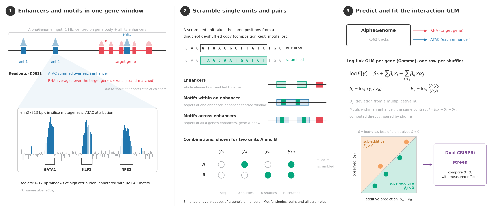

# AlphaGenome Element Epistasis

A lightweight wrapper around the [AlphaGenome](https://github.com/google-deepmind/alphagenome) API package for analysing the effects of single and pairwise *in silico* knockouts of functional genomic elements.

The package simulates *in silico* perturbations of user-defined functional elements (for example enhancers) and of attribution-derived motifs (seqlets called from ISM tracks) by replacing them with dinucleotide-shuffled sequence. Perturbation effects are then fitted with a log-link generalised linear model (GLM) to estimate main effects and pairwise epistasis. It also includes diagnostics for ceiling and floor artefacts of the predictor, so that non-additive terms caused by saturated or bounded predictions are not mistaken for regulatory interactions.



### What it estimates

For a baseline readout $y_0$ (predicted RNA or ATAC) and the readout $y_i$ after scrambling element $i$:

$$\delta_i = \log(y_i/y_0), \qquad I = \delta_{ij} - \delta_i - \delta_j = \log\frac{y_{ij}\,y_0}{y_i\,y_j}$$

The null is multiplicative. With the log-link GLM

$$\log E[y] = \beta_0 + \sum_i \beta_i \mathbf{1}_{i} + \sum_{i<j} \beta_{ij} \mathbf{1}_{ij}$$

the coefficients equal these contrasts exactly ($\beta_i = \delta_i$, $\beta_{ij} = I$), so they can be compared directly with interaction coefficients from dual CRISPR screens.

- $I < 0$: **super-additive**, the pair loses more together than the singles predict.
- $I > 0$: **sub-additive**, the pair loses less.

Each perturbed condition is predicted on several dinucleotide shuffles (10 by default), so p-values describe robustness to correction is applied within each family of tests.

- Factorial perturbation designs: full power set or a reduced design(baseline, singles, pairs, all-scrambled).
- Chunked AlphaGenome prediction driver with exponential backoff, so APIthrottling or gRPC errors do not abort a long run.
- Gamma or negative binomial log-link GLMs, fitted per gene or per measured locus; the perturbation unit can be a whole element or a seqlet.
- Model-free interaction and cooperativity scores as an independent check on the GLM.
- Specificity null from length-matched control windows.
- Saturation diagnostics: split-replicate estimation, partial correlation on $\log y_0$, and a floor check on the multiplicative null prediction.
- Validation against measured coefficients (sign concordance, calibration slope, Pearson and Spearman correlation).
- Plain-text summary reports and figures that share one palette and sign convention.

## Repository layout

```
alphagenome_element_epistasis/
├── src/
│   ├── element_epistasis/   package code
│   └── ism_attribution/     runner computing the ISM attributions
├── notebooks/
│   ├── 01_enhancer_knockout.ipynb        enhancer-level knockouts and GLM
│   └── 02_TF_motif_cooperativity.ipynb   seqlets, within- and cross-enhancer motif interactions
├── data/
│   ├── raw/         CRISPRi screen tables, enhancer BED file, TF list
│   ├── meta/        motif databases
│   ├── processed/   ISM attributions, AlphaGenome predictions, derived tables
│   └── reference/   hg38 FASTA and annotation cache (not version controlled)
├── results/
│   ├── summaries/   text reports written by the notebooks
│   └── figures/
├── tests/           test against synthetic data with known ground truth
└── env/             environment specs
```

See `data/README.md` for exact data formats.

## Getting started

```bash
pip install --no-deps -r env/requirements.lock.txt
pip install --no-deps -e .
```

The lock file works on Linux, Windows and Apple Silicon macOS; see `env/README.md` for conda and platform notes.

Run notebook 01 before notebook 02: it writes the enhancer-level main effects and interactions that the cross-enhancer motif analysis reads.

Both notebooks start with `RUN_PREDICTIONS = False`, which loads the stored AlphaGenome predictions from `data/processed`. Setting it to `True` regenerates them; that needs an API key in `ALPHAGENOME_API_KEY` (or `~/.alphagenome_api_key`), the hg38 reference in `data/reference` and several hours of API time.

## Example use

The dual enhancer CRISPRi screen data in `data/raw/` (enhancer coordinates and measured single-enhancer and pairwise interaction coefficients) were provided by Julia R. Bauman, Steinmetz Lab, Department of Genetics, Stanford University.

### Enhancer element interactions

Scramble every subset of the enhancers assigned to a gene inside one 1 Mb window, predict RNA at the target gene, and fit the interaction GLM.

Main functions:

- `glm.fit_all_genes` fits the log-link GLM per gene; `glm.collect_terms` flattens the coefficients into one table.
- `enhancer_analysis.split_coef_table` separates main effects from interactions; `enhancer_analysis.summarise_validation` compares them with measured coefficients.
- `enhancer_analysis.build_pairwise_epistasis` and `build_coop_table` give the model-free contrast; `build_interdependency` gives the effect of each enhancer on accessibility at every other enhancer.

```python
res   = glm.fit_all_genes(scram_effects, response_col="RNA_counts",
                          family="gamma", max_order=2, round_nb=False)
beta  = tc.add_bh_correction(glm.collect_terms(res))
mains, inters = ea.split_coef_table(beta)
```

See `notebooks/` for the full enhancer knockout walk-through.

### TF motif interactions

Call seqlets from ISM attribution, scramble them alone and in pairs, and
estimate interactions within one enhancer or across the enhancers of a gene.

Main functions:

- `tf_cooperativity.cap_seqlets_per_enhancer` keeps the strongest non-overlapping seqlets; `enumerate_combinations` builds the design; `sample_control_windows` draws the specificity null.
- `tf_cooperativity.predict_with_backoff` runs the AlphaGenome predictions.
- `tf_cooperativity.build_motif_effects`, `build_pairwise_interactions` and `build_cooperativity_table` give the effect tables; `build_saturation_split` and `build_floor_check` give the artefact diagnostics.
- For motifs across enhancers, `glm.fit_all_genes` is used with seqlets as the perturbation unit, and `glm.classify_interaction_terms` labels each pair as within- or across-enhancer.

```python
pairs = tc.add_bh_correction(
    tc.build_pairwise_interactions(scram_effects, "ATAC_counts", seqlets=seqlets))
coop  = tc.build_cooperativity_table(scram_effects, "ATAC_counts")
```

See `notebooks/` for the full TF motif walk-through.

## References

- Avsec, Ž. *et al.* Advancing regulatory variant effect prediction with AlphaGenome. *Nature* **649** (2026). doi:10.1038/s41586-025-10014-0
- Schreiber, J. tangermeme: a toolkit for understanding cis-regulatory logic using deep learning models. *bioRxiv* (2025). doi:10.1101/2025.08.08.669296
- Zhou, J. L. *et al.* Analysis of single-cell CRISPR perturbations indicates that enhancers predominantly act multiplicatively. *Cell Genomics* **4** (2024). doi:10.1016/j.xgen.2024.100672
- Karollus, A., Mauermeier, T. & Gagneur, J. Current sequence-based models capture gene expression determinants in promoters but mostly ignore distal enhancers. *Genome Biology* **24** (2023). doi:10.1186/s13059-023-02899-9
- Toneyan, S. & Koo, P. K. Interpreting cis-regulatory interactions from large-scale deep neural networks. *Nature Genetics* **56** (2024). doi:10.1038/s41588-024-01923-3
- Ovek Baydar, D. *et al.* JASPAR 2026: expansion of transcription factor binding profiles and integration of deep learning models. *Nucleic Acids Research* **54** (2026). doi:10.1093/nar/gkaf1209